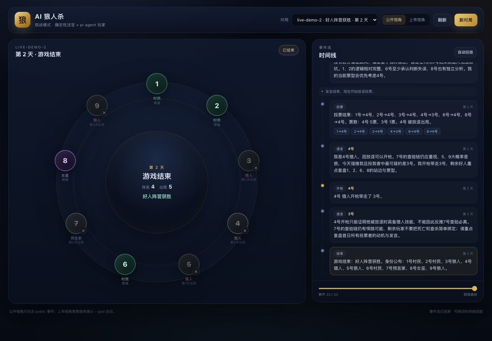
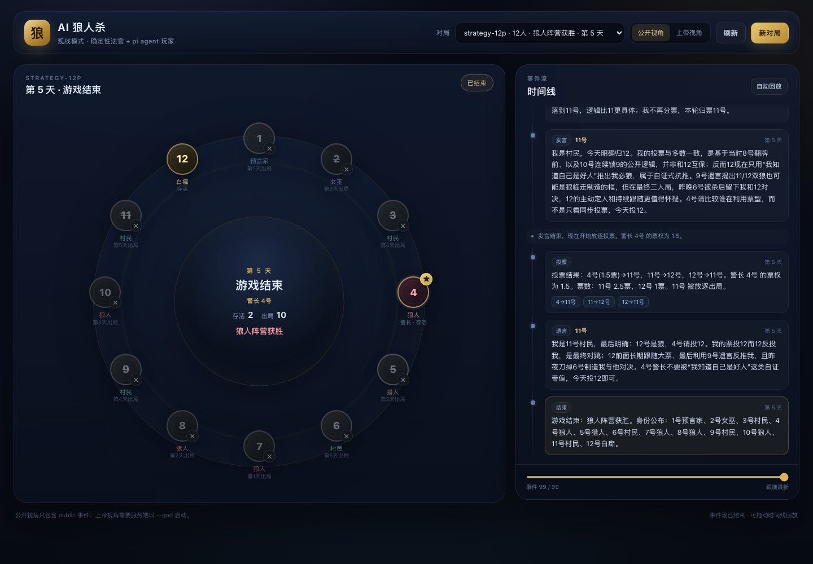
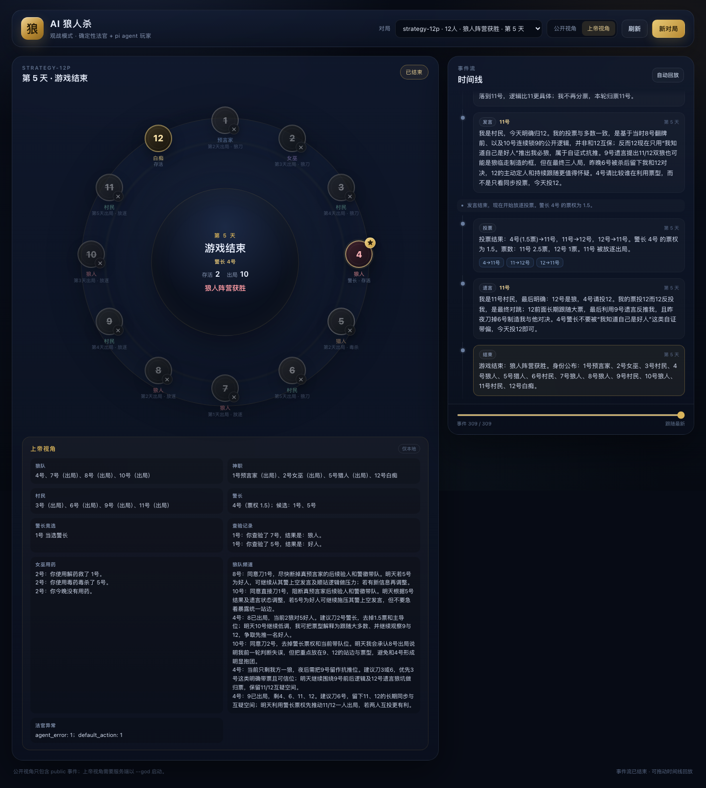

# AI 狼人杀

一个**全程由 AI 游玩**的狼人杀，支持 9 人标准局与 12 人预女猎白上警局：

- **法官是确定性程序**：发身份、夜晚结算、天亮、警长竞选、发言顺序、投票、放逐、猎人开枪、警徽移交、胜负判定，全部由 `GameEngine` 负责。
- **玩家是 pi agent loop 驱动的 LLM agent**：每个座位一个持久 `pi Agent`，拥有独立上下文和角色策略手册，通过 tool use 发言/上警/投票/刀人/查验/用药/开枪/移交警徽。
- **信息隔离**：每个 agent 只能看到自己有权看到的事件；狼队频道、查验结果、女巫用药不会泄露给错误的人。
- **可验证**：规则单测、30 局 9 人随机全流程、20 局 12 人随机全流程、fake-model 的 pi loop 集成测试、真实模型 smoke，一条命令跑完。

当前板子：
- **9 人局**：3 狼人、3 村民、预言家、女巫、猎人；无警长。
- **12 人局**：4 狼人、4 村民、预言家、女巫、猎人、白痴；第 1 天警长竞选，警长 1.5 票、死亡可移交警徽。夜晚死亡没有遗言。

## 快速开始

```bash
npm install

# 1) 不需要模型鉴权：随机策略跑完一局
npm run play -- --scripted --seed demo

# 12 人局（含警长竞选、白痴）
npm run play -- --mode 12p --scripted --seed demo-12p

# 2) 真实模型跑一局
npm run play -- --mode 12p --model openai-codex/gpt-5.6-luna --seed live-12p

# 3) 先用最小回合验证模型/工具链
npm run smoke:llm -- --model openai-codex/gpt-5.6-luna

# 4) 查看本机 pi 可用的模型
npm run doctor

# 5) 浏览器观战（默认公开视角）
npm run serve

# 6) 上帝视角 + 自动打开浏览器
npm run serve -- --god --open

# 7) 指定新对局默认板子
npm run serve -- --god --board 12p --open
```

真实模型会复用 pi 的登录状态（`~/.pi/agent/auth.json`，OAuth 或 API key），不需要在项目里重复配置 key。

## 观战前端





`npm run serve` 启动一个本地观战服务（默认 `http://127.0.0.1:7331`）：

- **9/12 人圆桌**：座位号、存活/出局、白痴翻牌、警长徽记、当前行动者高亮。
- **公开视角 / 上帝视角**：公开视角只接收 `public` 事件；上帝视角需要服务端 `--god`，显示身份、狼队频道、查验、女巫用药、警长竞选和死因。
- **实时时间线**：SSE 推送，自动跟随；可拖动滑块回放、自动回放；上警、竞选发言、警长票、警徽移交和白痴翻牌都会进入时间线。
- **浏览器内开新局**：可选 9 人 / 12 人、脚本模式或真实模型；模型列表来自 pi 当前可用模型。
- **自动发现对局**：扫描 `runs/`，CLI 正在跑的对局也能直接观战。




观战服务只读 `runs/<gameId>/events.ndjson`，不会暴露 `transcripts/`，也不参与游戏状态。公开视角在服务端过滤掉 `seat` / `wolves` / `judge` 事件；`--god` 是唯一的私密信息开关。默认只绑定 `127.0.0.1`，不要在没有额外保护时把 `--host 0.0.0.0` 和 `--god` 一起暴露到公网。

## 验证

```bash
npm run verify
```

包含：

- `tsc --noEmit`
- 34 个测试
  - 规则单测：夜晚结算、女巫双药、猎人毒杀、投票平票、胜负优先级、信息可见性
  - 30 个 9 人种子 + 20 个 12 人种子的随机全流程：每局必须正常结束、胜者非空、事件 seq 连续、恰好一个 `game_end`、无非法动作；12 人局必须恰好一次警长竞选，夜间死亡不得有遗言
  - 12 人专项：上警、警长竞选投票、1.5 票、警徽移交、白痴翻牌免死/失去投票权、猎人开枪遗言
  - pi agent loop 集成测试：用 fake model stream 走真实 `Agent` + 真实工具 schema，验证工具接受/拒绝、纠正提示、重复行动阻止、fatal 错误、警长工具
  - 观战服务：静态页、配置、脚本对局、12 人上警 SSE、公开/上帝过滤、403/404/路径穿越防护
- 两局通过真实 CLI 的 scripted 对局（9 人 + 12 人），并检查 `summary.json` 不变量
- 一局真实模型的 9 人局（本地运行产物 `runs/live-demo-2`，gitignored）
- 一局真实模型的 12 人上警局（`runs/strategy-12p`，gitignored；medium thinking，5 天，309 事件，1 次超时保底；策略观察见 [strategy-eval.md](docs/agent/strategy-eval.md)）

## 架构

```
┌──────────────────────────────────────────────────────────────┐
│ GameEngine（纯 TS，唯一状态源）                               │
│  advance() ──► TurnRequest（谁 / 什么行动 / 合法目标）        │
│  submit(Action) ──► 规则校验 + 结算 + 事件                    │
└───────────────┬──────────────────────────────────────────────┘
                │ PlayerView + brief（按 visibility 过滤）
                ▼
┌──────────────────────────────────────────────────────────────┐
│ PiPlayer（每个座位一个持久 pi Agent）                         │
│  system prompt：身份 + 完整规则 + 角色策略手册 + 行为准则     │
│  每回合 tools：say / vote / sheriff_run / transfer_badge / ...│
│  shouldStopAfterTurn：terminal tool 被接受即结束 agent loop   │
└───────────────┬──────────────────────────────────────────────┘
                │ Action
                ▼
         GameEngine.submit()
                │
                ▼
   events.ndjson / summary.json / transcripts/
```

更完整的设计见 [docs/design/architecture.md](docs/design/architecture.md)，规则见 [docs/rules/9p.md](docs/rules/9p.md) 与 [docs/rules/12p.md](docs/rules/12p.md)。

观战前端是同一份事件流的只读消费者：

```
GameEngine ──► events.ndjson ──► SSE /api/games/:id/events?view=public|god
                                        │
                                        ▼
                                  web/ 观战页面
```

它不修改游戏状态，也不参与规则判定；公开视角的过滤在服务端完成。

## 一回合是怎么发生的

1. `GameEngine.advance()` 自动播报/结算，直到需要某个玩家行动。
2. Runner 用 `makePlayerView()` 生成该玩家的可见视图：
   - 当前天数/阶段/存活座位
   - 私密信息（狼队友、查验记录、药剂、今晚刀口）
   - **自他上次行动以来**的可见事件增量
   - 本回合合法目标和行动提示
3. `PiPlayer` 把简报作为 user message 交给持久 agent；只挂载本阶段合法的工具。
4. Agent 调用 `say` / `vote` / `wolf_vote` / `sheriff_run` / `transfer_badge` / ...；工具闭包校验参数并写入 `TurnHandle.action`。
5. `shouldStopAfterTurn` 发现行动已提交，结束本轮 agent loop。
6. Runner 把 `Action` 交给 `GameEngine.submit()`；引擎校验、结算、追加事件，回到 1。

如果 agent 只输出文字、调用非法目标、模型超时或 provider 出错：

- 非法目标 → 工具返回拒绝原因，agent 可以重试；
- 只输出文字 → 法官发一次纠正提示；
- 仍不行动 / 超时 → 使用该回合的合法保底动作（弃票、空刀、不用药、放弃开枪等）；
- fatal（鉴权/模型不支持）或连续失败 → 中止并留下完整证据。

## 策略提示词

相比只给规则，现在每个玩家额外拿到：

- **角色策略手册**：胜负计算、狼人刀法/伪装、预言家验人与起跳、女巫用药、猎人枪法、白痴翻牌、警长竞选与警徽流。
- **每回合决策检查**：按当前动作给出“这一刀/这一验/这一票如何推动阵营胜利”的检查清单。
- **公开局势摘要**：自动提取公开发言里的自称、查杀/金水，附最近票型和警长竞选结果（明确标注可能是谎言）。
- **按需策略工具**：`view_strategy` 随时重新读取本局身份对应的策略手册。

实测见 [docs/agent/strategy-eval.md](docs/agent/strategy-eval.md)：12 人局 `gpt-5.6-luna` + `--thinking medium` 已经出现预言家起跳、警徽流、对跳比较、票型复盘和狼人带队。代价是 12 分钟、约 117 万 total tokens；成本敏感时用 `low`，或只跑 9 人局。

## 为什么这样设计

- **法官驱动而非 agent 自主轮询**：流程确定、不会死锁、事件可回放；agent 只负责主观选择。
- **每阶段只暴露合法工具**：从接口层减少“夜晚投票”“死人发言”等违规；同时让规则更容易被模型理解。
- **每个玩家独立上下文**：天然信息隔离；不会把查验结果/狼队频道发给错误玩家。
- **完整规则进 system prompt**：规则正确性优先；system prompt 稳定，便于 provider prompt cache。
- **所有异常留痕**：`events.ndjson` + 每个座位的 `transcript` + `summary.json`，失败可定位到层。

## 输出

每局写到 `runs/<gameId>/`：

```
events.ndjson          # 权威事件流（public/seat/wolves/judge 四种可见性）
summary.json           # 胜者、天数、身份、死亡、异常、token 用量
transcripts/
  seat-1.jsonl         # 该玩家的 system prompt + 每轮简报 + 工具调用/结果
  ...
```

常用命令：

```bash
# 浏览器实时观战 / 回放
npm run serve
npm run serve -- --god

# 人类可读回放
npm run replay -- runs/<gameId>

# 看私密信息和身份
npm run replay -- runs/<gameId> --show-private --show-roles

# 查异常
jq -c 'select(.type=="agent_error" or .type=="default_action" or .type=="action_rejected")' \
  runs/<gameId>/events.ndjson

# 看某个玩家为什么这么发言
cat runs/<gameId>/transcripts/seat-3.jsonl
```

## CLI

```bash
node src/cli/play.ts [选项]
  --seed <string>        随机种子
  --game-id <string>     对局 ID
  --out <dir>            输出目录（默认 runs/<gameId>）
  --mode <9p|12p>        板子（默认 9p；12p 含上警与白痴）
  --scripted             无 LLM 随机策略
  --model <provider/id>  玩家模型
  --thinking <level>     minimal|low|medium|high|xhigh|max（默认 low）
  --max-tokens <n>       单次模型输出上限
  --max-days <n>         最大天数
  --timeout <seconds>    单回合超时
  --show-private         打印私密/狼队事件
  --verbose              打印工具调用与流程
  --quiet                只打印摘要

node src/cli/replay.ts <run目录|events.ndjson> [--show-private] [--show-roles] [--verbose]
node src/cli/serve.ts [--god] [--board 9p|12p] [--port 7331] [--host 127.0.0.1] [--open]
node src/cli/doctor.ts [--live] [--model ...]
node src/cli/smoke.ts [--model ...]
```

## 模型

- 通过 pi `ModelRuntime` 读取 `~/.pi/agent/auth.json`，支持 OAuth 刷新。
- `npm run doctor` 列出当前账号可用模型。
- 如果默认模型报 `model ... is not supported`，用 `--model` 指定账号可用的模型。本机实测 `openai-codex/gpt-5.6-luna`、`gpt-5.6-terra` 可用。
- 真实一局大约 50-80 次模型调用（12 人局更多），每次输入约 1.5-5k tokens。注意成本与耗时。
- 想看到更多谋略，建议用 `--thinking medium` 或 `high`，并在 12 人局使用支持较强推理的模型；策略手册已内置在 system prompt，也可通过 `view_strategy` 工具随时查看。

## 目录

```
src/engine/   纯规则与状态机
src/judge/    驱动、简报、记录、保底动作
src/agents/   pi 玩家、工具、规则、模型、scripted
src/server/   观战 HTTP/SSE 服务
src/cli/      play / replay / serve / doctor / smoke
web/          无构建步骤的观战前端（HTML/CSS/JS）
test/         规则 / 全流程 / pi loop / runner / 观战服务
docs/         架构、规则、验证回路、取证表
runs/         运行产物（gitignored）
```

## 已知限制

- 12 人局使用预女猎白 + 上警；警长能力目前是 1.5 票 + 死亡移交警徽，未实现警长决定发言顺序/警徽流自动执行。
- 未实现守卫、白狼王、狼美人、PK 二次投票、自爆等扩展规则。
- 回合串行执行；没有并行夜间行动。
- 未实现长上下文压缩；12 人局通常仍在 128k 内。
- 机器只判定规则/流程，不判定发言质量；策略提升依赖提示词、模型和 thinking level。
- 观战服务没有登录/鉴权，默认只监听 `127.0.0.1`；`--god` 会暴露身份和私密信息，不要直接暴露到公网。
- transcript 含私密信息，仅用于本地调试。

## 后续

- 守卫/白狼王等扩展角色，以及警长决定发言顺序、PK 二次投票
- 更强的策略评估：发言质量评分、阵营胜率统计、多模型对照
- 更丰富的观战 UI（图表、对局对比、导出）
- 真人玩家接入同一 `PlayerPolicy` 接口
