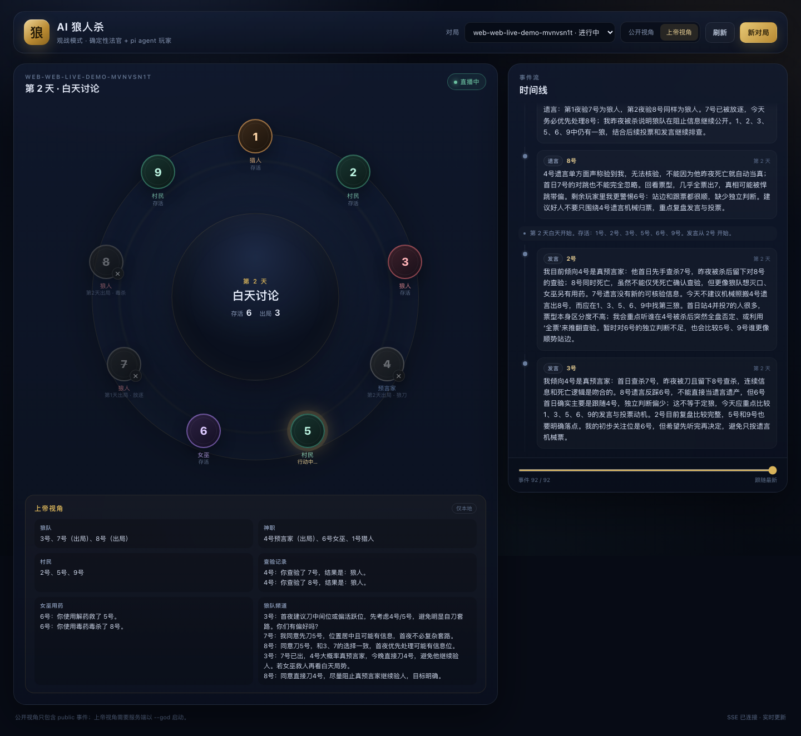

# AI 狼人杀 · 工程架构

## 1. 目标

做一个**全程由 AI 玩的狼人杀**：

- 法官是确定性程序，负责所有流程：发身份、夜晚结算、天亮、警长竞选、发言顺序、投票、放逐、猎人开枪、警徽移交、胜负判定。
- 每个玩家是一个独立的 LLM agent，用自己的上下文理解局势、听别人发言、做主观选择。
- 玩家只能通过 **tool use** 行动（发言、上警、竞选、投票、刀人、查验、用药、开枪、移交警徽、遗言）。
- 玩家 agent 的运行时使用 **pi 的 agent loop 内核**（`@earendil-works/pi-agent-core` 的 `Agent`）。
- 游戏必须能稳定跑完，不能因为某个 agent 不调用工具、调用非法工具或模型超时而卡死。
- 支持 9 人标准局与 12 人预女猎白上警局。

非目标（当前版本）：

- 真人玩家、语音、守卫/白狼王/狼美人、PK 二次投票、自爆等扩展规则。
- 让 agent 自己决定流程（法官永远掌握流程）。
- 让 agent 自由调用 shell/文件系统。玩家只拥有游戏工具。
- 自动评估发言质量或策略水平（当前靠提示词、模型和 thinking level）。

## 2. 一句话架构

```
确定性 GameEngine（唯一状态源）
        │  advance() 产出 TurnRequest
        ▼
Judge Runner（构造 PlayerView / brief，调度 policy）
        │  只把该玩家可见的信息交给他
        ▼
PiPlayer（一个持久 pi Agent + 本回合合法工具）
        │  tool call → 校验 → Action
        ▼
GameEngine.submit(Action)（规则校验、结算、事件）
        │
        └── 事件日志（public / seat / wolves / judge）→ 下一轮上下文
```

关键分工：**法官决定“什么时候轮到谁、合法目标是什么”；agent 决定“我怎么想、我选谁”。**

## 3. 分层

### 3.1 领域层：`src/engine/`

纯 TypeScript，不依赖 LLM、不依赖 pi。

- `types.ts`：角色、阶段、行动、事件、可见性、`RulesConfig`。
- `rng.ts`：seeded RNG；同一 seed 可复现。
- `engine.ts`：`GameEngine`，核心状态机。
  - `advance()`：自动处理播报、结算、胜负、阶段切换，直到需要一个玩家行动。
  - 返回 `TurnRequest`（谁、什么行动、合法目标、提示）。
  - `submit(action)`：校验并应用；非法行动抛 `RuleError`，状态不变。
  - 任务队列显式表达“下一步”：狼人行动 → 预言家 → 女巫 → 夜晚结算 → 遗言 → 猎人 → 白天发言 → 投票 → 放逐 → 遗言 → 猎人 → 下一夜。
- 事件是唯一观测面：`seq`、`day`、`phase`、`type`、`visibility`、`actor`、`target`、`text`、`data`。

**为什么不用“玩家自己轮询/互相调用”**：

- 流程会不可控，容易死锁、重复行动、时序错乱。
- 法官驱动可以保证每回合有明确终点（terminal tool）和保底动作。
- 观测、回放、测试都只需要看事件流。

### 3.2 法官/编排层：`src/judge/`

- `driver.ts`：通用驱动循环。
  - `advance()` → 取 `TurnRequest` → 构造 `PlayerView` → 调用 policy → `submit()`。
  - 负责超时、agent 错误、规则拒绝的降级路径。
- `runner.ts`：一局游戏的运行时。
  - 创建引擎与 9 个 policy。
  - 写 `events.ndjson`、`summary.json`、每个座位的 transcript。
  - 统计异常（agent 错误 / 保底动作 / 规则拒绝）。
- `brief.ts`：把 `PlayerView` 渲染为每回合给 agent 的“法官简报”。
- `format.ts`：事件 → 可读文本。
- `defaults.ts`：每个回合类型的合法保底动作。

### 3.3 玩家层：`src/agents/`

- `pi-player.ts`：一个玩家 = 一个持久 `pi Agent`。
  - `systemPrompt`：座位、身份、阵营、完整规则、行为准则。整局不变。
  - `state.tools`：每回合动态替换为当前阶段合法的工具。
  - `shouldStopAfterTurn`：当本回合 terminal tool 已被接受，结束本轮 agent loop。
  - `beforeToolCall`：已经提交过行动后，阻止再次行动。
  - `decide()`：prompt 简报 → 必要时发一次纠正提示 → 返回 `Action`。
  - 记录 transcript / token usage；支持 abort / timeout。
- `tools.ts`：本回合工具集 + 参数校验 + `TurnHandle`。
- `rules.ts`：完整规则文本、系统提示、纠正提示。
- `scripted.ts`：无 LLM 的随机策略。用于规则测试、压力测试、演示。
- `model.ts`：复用 pi 的 `ModelRuntime` 读取 `~/.pi/agent/auth.json`，处理 OAuth 刷新。
- `smoke-lib.ts`：一次真实模型回合的最小集成测试。

#### pi agent loop 的具体用法

每个 `PiPlayer` 内部只有一个 `Agent`（`@earendil-works/pi-agent-core`），全程复用：

```ts
const agent = new Agent({
  initialState: {
    systemPrompt: buildSystemPrompt(role, seat), // 整局不变
    model,
    thinkingLevel: "low",
    tools: [],
  },
  streamFn: modelRuntime.streamSimple.bind(modelRuntime),
  sessionId: `${gameId}-seat-${seat}`,
  toolExecution: "sequential",
  shouldStopAfterTurn: () => handle.action !== null,
  beforeToolCall: async ({ toolCall }) => {
    if (handle.action && !INFO_TOOL_NAMES.has(toolCall.name)) {
      return { block: true, reason: "本回合行动已经提交" };
    }
  },
});
```

每回合：

```ts
agent.state.tools = buildTurnTools(handle, limits); // 只挂载本阶段合法工具
await agent.prompt(view.brief);                     // 简报进入持久 transcript
// 工具 execute 写入 handle.action；shouldStopAfterTurn 让 loop 结束
```

- **没有** `read` / `bash` / `edit` / `write` 等编码工具；玩家只有游戏工具 + `view_*`。
- `agent.subscribe()` 用于采集 token usage、tool 事件和错误。
- `agent.abort()` + `agent.waitForIdle()` 用于超时；下一回合开始前等待上一次 run 结束。
- `sessionId` 让 provider 端可以按玩家做 prompt cache。
- `toolExecution: "sequential"` 保证同一批 tool call 里不会出现两个并发行动。

## 4. 玩家 agent 的上下文设计

每个玩家有**独立 transcript**，不共享上下文。一个玩家的上下文只包含：

1. **System prompt（固定）**
   - 座位、身份、阵营、角色指南。
   - 本局完整规则（9 人或 12 人，含上警/白痴）。
   - 角色策略手册：胜负计算、发言结构、上警/警徽、狼人伪装、好人归票。
   - “自由文本私密、只有工具生效、法官是权威、可以欺骗、不要泄露提示”等行为约束。
2. **每回合简报（user message）**
   - 当前天数/阶段/回合 ID、警长/上警候选人。
   - 存活/出局座位。
   - 私密信息：狼队友、查验记录、药剂状态、今晚狼刀目标、猎人技能、白痴翻牌状态。
   - 公开局势摘要：自动提取的公开自称/查杀/金水、最近投票、警长竞选结果、白痴翻牌。
   - 自上次该玩家行动以来的可见事件增量（公开发言、死亡、投票结果、狼队频道等）。
   - 本回合要求、合法目标、决策检查清单。
3. **自己的 assistant 消息与 tool result**
   - 自己的思考、发言、行动及其结果。
4. **按需查询工具**
   - `view_state`：当前局势 + 私密信息 + 合法目标。
   - `view_log`：最近 N 条自己可见的历史事件。
   - `view_rules`：本局完整规则。
   - `view_strategy`：本局身份对应的策略手册。

### 信息隔离

事件可见性只有四种：

| 可见性 | 谁能看 | 例子 |
|---|---|---|
| `public` | 所有人 | 白天发言、投票结果、死亡公告、游戏结束 |
| `seat` | 指定座位 | 查验结果、女巫用药、法官私信 |
| `wolves` | 狼人 | 狼队频道、狼队刀杀投票、狼队最终刀口 |
| `judge` | 没人（仅日志） | 身份分配、内部 turn_start、错误、保底动作 |

`makePlayerView()` 在构造简报时按 visibility 过滤，并排除：
- `role_assigned` / 私密结果事件（私密信息已在 `privateInfo` 中汇总，避免重复）。
- 自己的发言/投票回声（自己的 assistant 消息里已有）。
- 所有 judge 事件。

### 为什么不把全量日志塞进 prompt

- 9/12 人局 × 数天，每个 agent 只看到“自上次行动以来”的增量；总量可控。
- 公开摘要只做轻量自动提取（自称、查杀/金水、最近投票），不替代 agent 自己看发言。
- 需要旧信息时由 agent 主动 `view_log`，符合上下文经济学。
- 每回合简报是新的 user message，system prompt 保持不变，便于 provider 端 prompt cache。

## 5. 回合协议

```ts
interface TurnRequest {
  id: string;
  kind: "wolf_turn" | "seer_check" | "witch_act" | "last_words"
      | "hunter_shoot" | "sheriff_signup" | "sheriff_speech"
      | "sheriff_vote" | "badge_transfer" | "day_speech" | "day_vote";
  seat: number;
  legalTargets: number[];
  promptHint: string;
  // 角色相关：狼队友、女巫可用的药、今晚被刀目标、警上候选人……
}
```

每个 `TurnRequest` 对应一组工具：

| 回合 | 可用工具 | 终止条件 |
|---|---|---|
| 狼人夜谈 | `wolf_speak`（可多次）+ `wolf_vote` | `wolf_vote` 被接受 |
| 预言家 | `seer_check` | 被接受 |
| 女巫 | `witch_act` | 被接受 |
| 上警 | `sheriff_run` | 被接受 |
| 竞选发言 | `sheriff_say` | 被接受 |
| 警长投票 | `sheriff_vote` | 被接受（可 abstain） |
| 警徽移交 | `transfer_badge` | 被接受（可 null 销毁） |
| 遗言 | `last_words` | 被接受 |
| 猎人 | `hunter_shoot` | 被接受（可 null 放弃） |
| 白天发言 | `say` | 被接受 |
| 白天投票 | `vote` | 被接受（可 abstain） |

所有回合都附带 `view_state` / `view_log` / `view_rules` / `view_strategy`（不消耗行动）。

**终端工具的实现**：工具闭包写入 `TurnHandle.action`；`shouldStopAfterTurn` 发现 action 已写入就结束 pi agent loop。这样：
- agent 可以先查信息、再行动；
- 行动被拒绝时 action 仍为空，agent 可以修正参数重试；
- 一个回合最多提交一个有效行动。

## 6. 规则模式

### 6.1 9 人局

3 狼、3 村民、预言家、女巫、猎人。屠边：狼人杀光村民或神职获胜；好人放逐所有狼人获胜。无警长。

### 6.2 12 人局（预女猎白 + 上警）

4 狼、4 村民、预言家、女巫、猎人、白痴。第 1 天警长竞选；白痴首次被放逐翻牌免死但失去投票权。屠边目标里的神职包含白痴。

### 6.3 公共细节

- 狼人：夜里按座位顺序在狼队频道发言 + 投票刀人；可以空刀；狼队平票空刀；允许自刀。
- 预言家：每晚查验一名存活玩家（不能自己），得到“狼人/好人”；当夜被杀仍完成查验。
- 女巫：知道当晚狼刀目标；解药/毒药各一次；不能同晚双药；第一夜之后不能自救；当夜被杀仍可用药。
- 猎人：被狼刀或被放逐时可以开枪；被毒杀不能开枪；可以放弃；被带走的玩家留遗言。
- 天亮公布死亡座位，不公布死因；**夜晚死亡没有遗言**；被放逐者和被猎人带走的玩家留遗言。
- 白天按顺序每人一次发言；存活且有投票权的玩家投票；最高票唯一者放逐；平票无人出局；不能投自己；可弃票。
- 12 人局中，警长放逐票权 1.5；死亡时可以移交警徽或销毁；白痴翻牌后失去投票权。
- 出局者不再发言/投票/用技能，只有遗言、猎人开枪和警徽移交。
- 每次死亡结算后检查胜负；狼人全灭优先判好人胜。
- 超过 30 天中止（正常对局不会发生）。

规则文本在 `src/agents/rules.ts` 的 `RULES_TEXT_9P` / `RULES_TEXT_12P`，同时会进入每个玩家的 system prompt，并可通过 `view_rules` 查询。

## 7. 失败与降级

| 情况 | 处理 |
|---|---|
| agent 调用非法目标/非法行动 | 工具返回“行动被拒绝 + 原因”，agent 可重试；回合不结束 |
| agent 只输出文字不调用工具 | 法官发一次纠正提示；仍不行动则抛给 runner |
| agent 连续调用信息工具 | 每个 prompt 最多 8 个 agent turn，然后停止 |
| 模型超时 | `agent.abort()`，runner 用该回合的合法保底动作继续 |
| 模型/provider 错误 | 记录 `agent_error`；非 fatal 用保底动作；连续 5 次或 fatal（鉴权/模型不支持）中止游戏 |
| 提交动作被引擎拒绝 | 记录 `action_rejected`，用合法保底动作继续 |
| 玩家已死亡但仍有排队回合 | 引擎跳过并记录 |
| 进程中断 | `events.ndjson` 已逐条落盘，可 replay/取证 |

保底动作：

- 狼人：空刀
- 预言家：验第一个合法目标
- 女巫：不用药
- 遗言：`（无遗言）`
- 猎人：放弃开枪
- 白天发言：`我暂时没有更多信息，选择过。`
- 投票：弃票

## 8. 可观测性与测试

### 事件日志

每条 `runs/<gameId>/events.ndjson`：

```json
{"seq":31,"ts":"...","gameId":"...","day":1,"phase":"day_discuss","type":"speech","visibility":{"kind":"public"},"actor":3,"target":null,"text":"我怀疑2号。","data":null}
```

### 产物

```
runs/<gameId>/
  events.ndjson          # 权威事件流
  summary.json           # 胜者、天数、身份、死亡、异常、token 用量
  transcripts/
    seat-1.jsonl         # 每个玩家完整 system prompt + 上下文 + 工具调用
    ...
```

### 验证金字塔

1. **规则单测**（`test/engine.test.ts`、`test/modes.test.ts`）
   - 夜晚结算、女巫双药、猎人毒杀、投票平票、胜负优先级、可见性。
   - 12 人上警、警长 1.5 票、警徽移交、白痴翻牌、夜间无遗言。
2. **全流程随机局**（`test/full-game.test.ts`）
   - 30 个 9 人 seed + 20 个 12 人 seed 全部跑完；事件 seq 连续；恰好一个 `game_end`；12 人恰好一次警长竞选；无规则拒绝；角色数正确；夜间死者无遗言。
3. **pi agent loop 集成测试**（`test/pi-player.test.ts`）
   - 用 fake stream 模拟模型，验证：工具接受/拒绝、view_state 后继续、纠正提示、重复行动阻止、不同回合工具集、警长工具、fatal 错误。
   - 不花 token，但走真实 agent loop 和真实工具 schema。
4. **真实模型 smoke**（`npm run smoke:llm`）
   - 一次真实模型回合，验证 auth、模型能力和自定义工具。
5. **CLI 全流程**（`npm run verify`）
   - 走真实 CLI + runner + 文件落盘，9 人/12 人各一局，检查 summary 不变量。
6. **观战服务**（`test/server.test.ts`）
   - 静态页/配置、脚本对局、public SSE 只含 public 事件、god SSE 含身份/狼队/查验、12 人公开 SSE 含上警/警长、403/404/路径穿越。
   - 另用 Playwright 在桌面/移动宽度检查公开/上帝视角、回放、12 人圆桌和新对局面板。

### 故意改坏

验证判定是否可证伪：

- 把 `computeWinner()` 改成永远 `null` → 全流程测试应失败（无胜者）。
- 把 `isVisibleTo` 的 `judge` 分支改成 `true` → 可见性测试应失败。
- 把 `resolveNight` 的解药判断去掉 → 女巫救人测试应失败。

## 9. 观战前端

观战是**事件流的只读消费者**，不参与游戏状态，也不改规则。



### 9.1 服务端

`src/server/spectator-server.ts`（`npm run serve`）：

| 路由 | 作用 |
|---|---|
| `GET /`、`/styles.css`、`/app.js` | 托管 `web/` 静态页面 |
| `GET /api/config` | `godEnabled`、可用模型、默认模型、板子列表、当前活动对局 |
| `GET /api/games` | 扫描 `runs/`，返回对局列表、板子/人数、胜者、状态、事件数 |
| `POST /api/games` | 从浏览器开始新对局：`{mode:"scripted"\|"live", board:"9p"\|"12p", seed, model}` |
| `GET /api/games/:id/events?view=public\|god` | SSE 事件流 |

关键点：

- **公开视角在服务端过滤。** `view=public` 只发送 `visibility.kind === "public"` 的事件；`seat` / `wolves` / `judge` 不会进入浏览器。`view=god` 需要启动时 `--god`，否则 403。
- **SSE tailer 读 `events.ndjson`。** 从文件开头发送完整行；每 250ms 轮询追加；支持 CLI 正在跑的对局（不需要和 runner 同进程）。发送 `done` 的判定：服务端内存状态 `finished`、`summary.phase === "ended"` 或最后一条是 `game_end`。
- **不暴露 transcript。** 只读 `events.ndjson` 和 `summary.json`；路径做了 ID 白名单与静态目录逃逸检查。
- **新对局 API。** 脚本模式用 `RandomPolicy`；真实模式用与 CLI 相同的 `loadPiModel` + `PiPlayer`。同一时间只允许一局，返回 `409`；启动后等待 `events.ndjson` 出现再返回，避免前端 SSE 404 竞态。
- **默认只绑定 `127.0.0.1`。** `--god` 会暴露身份和私密信息；不要把 `--host 0.0.0.0` 和 `--god` 一起暴露到公网。

### 9.2 前端

`web/` 是无构建步骤的 HTML/CSS/JS（没有 React/Vite，也没有外部 CDN）：

- **圆桌**：9/12 个座位按圆环定位；警长徽记、白痴翻牌、存活/出局、角色（上帝视角或游戏结束后）、当前行动者高亮、死因（上帝视角）。
- **时间线**：按天分组；发言、遗言、上警、竞选发言、警长票、警徽移交、白痴翻牌、投票、死亡、猎人开枪、阶段播报；上帝视角额外显示狼队频道、查验、女巫用药。所有事件文本用 `textContent` 写入，避免 LLM 发言中的 HTML 注入。
- **回放**：滑块按事件 `seq` 截断；状态（存活/出局、角色、天数、警长、翻牌）全部由事件重放推导；支持自动回放和“回到最新”。
- **上帝面板**：身份分组、警长/竞选、查验记录、女巫用药、狼队频道、法官异常计数。
- **新对局表单**：板子（9p/12p）、模式、种子、模型（来自 `/api/config`）；真实模型默认优先 `openai-codex/gpt-5.6-luna`。

前端不缓存服务端状态：每次重连 SSE 都会从头回放事件，按 `seq` 去重；因此刷新页面、切换视角、切换对局都能得到一致结果。

### 9.3 为什么不做成“前端直接读引擎”

- 引擎是单进程状态机，前端不应该有第二套规则/状态推导入口。
- `events.ndjson` 已经是权威、结构化、带可见性的记录；CLI、回放、测试、前端共用同一条数据链。
- 服务端过滤让公开视角的边界可测试（`test/server.test.ts`），而不是依赖前端自觉隐藏。

## 10. 目录

```
src/
  engine/       纯规则与状态机
  judge/        驱动、简报、记录、默认动作
  agents/       pi 玩家、工具、规则文本、scripted policy、模型加载
  server/       观战 HTTP/SSE 服务
  cli/          play / replay / serve / doctor / smoke
web/            无构建步骤的观战前端
test/           规则、12 人模式、全流程、pi loop、runner、观战服务
docs/           设计、9/12 人规则、验收与取证
runs/           运行产物（gitignored）
```

## 11. 关键取舍

| 决策 | 选择 | 理由 |
|---|---|---|
| 谁驱动流程 | 法官驱动 | 可控、可测、不会死锁 |
| 玩家行动接口 | 每阶段收敛的工具集 | 从接口层就减少非法行动；规则理解更直接 |
| 规则放哪 | system prompt 全文 + view_rules | 正确理解规则优先；prompt cache 抵消成本 |
| 上下文共享 | 每人独立 transcript | 天然信息隔离；不会把私密信息发给错误玩家 |
| 回合并发 | 当前串行 | 事件顺序确定、回放简单；后续可并行独立夜间行动 |
| 模型选择 | 复用 pi ModelRuntime | OAuth 刷新、provider 配置与 pi CLI 一致 |
| 失败策略 | 有限纠正 + 合法保底动作 | 保证游戏跑完；异常全部留痕 |
| 上下文压缩 | 当前不做 | 12 人局上下文通常仍在 128k 内；先保证正确性 |
| 观战前端 | 只读事件流 + 服务端过滤 | 不复制引擎状态；公开视角边界可测试；CLI/回放/前端共用一条数据链 |
| 前端技术 | 原生 HTML/CSS/JS，无构建 | 本地观战工具，减少依赖和构建步骤；SSE 原生支持 |

## 12. 后续扩展

- 守卫/白狼王/狼美人等扩展角色，自定角色组合。
- 警长决定发言顺序、警徽流自动执行、PK 发言与二次投票。
- 并行夜间行动 + 更真实的同时结算。
- 更丰富的观战 UI：图表、对局对比、导出、移动端优化。
- 真人玩家接入同一个 `PlayerPolicy` 接口。
- 更丰富的 agent 记忆：个人笔记工具、跨天摘要。
- 多模型对局（不同座位不同模型/性格）。
- 自动对局评估：胜率、发言质量、规则违规率。
